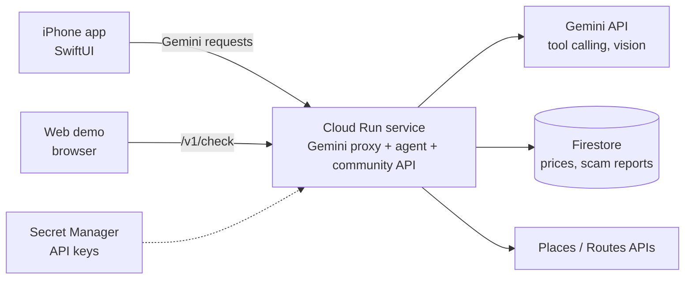

# Candor: submission guide

Step by step from "code on a Mac" to "a submission that meets every rule". Do the steps in order.

## 1. Deploy the backend on Cloud Run (required by the rules)

Follow `backend/gemini-proxy/README.md` → *Deploy*. It creates one Cloud Run service with:

- the Gemini proxy the iPhone app uses (the API key stays in Secret Manager, not in the app),
- the fair-price agent and web demo (`/`),
- community prices and scam reports in Firestore,
- the Gemini-written brief for tourism offices.

Check: open the service URL in a browser. You should see the Candor web demo, and
`/healthz` should say `"store":"firestore"`.

## 2. Connect the iPhone app

1. Paste the URL into `Candor/App/Backend.swift` → `geminiProxyURL`.
2. Remove `GEMINI_API_KEY` from `Keys.xcconfig` (the app no longer needs it), and rotate the old key in
   Google AI Studio, since it was shared during development.
3. Build and run. Tap ✨ on Home (Ask Candor) and ask: *"Auto to India Gate, driver wants ₹300"*. The step trail
   should now include **Checking what travellers paid**.
4. Me → Preferences shows **Share my checks anonymously** (on by default, can be turned off).

## 3. Fill the community data honestly

Before recording, run 10–20 real checks yourselves (web demo and app) for a few common items:
chai, water, an auto ride, a market item. Share what you paid. Don't invent "traveller" data; if you
add test rows, say in the demo that they are test data.

## 4. What judges get (no TestFlight needed)

| Item | Where |
|---|---|
| Live web demo | Your Cloud Run URL (works on any phone or laptop) |
| Demo video, 2–3 min | YouTube (unlisted) or Drive link |
| Code | GitHub repo (check `Keys.xcconfig` is git-ignored and no keys are committed) |
| Architecture diagram | Below, or export it as an image |

### Demo video script (2.5 min)

1. **Problem (15 s):** "Tourists in India are often quoted many times the local price. They can't tell what's fair, and honest sellers lose trust."
2. **Price check (45 s):** photograph a menu or type "auto to India Gate, ₹300". Show the agent's steps (reading the photo, community prices, fare chart) and the verdict with a polite Hindi phrase.
3. **Community (30 s):** share what you paid; open *What travellers paid* to show the median. "Every check makes the next one better."
4. **For the city (30 s):** *Scam hotspots* → *Write a brief for the tourism office*: Gemini turns reports into actions.
5. **Trip companion (20 s):** Home, a planned day, getting around with fair fares, the way back home.
6. **Close (10 s):** Gemini + Cloud Run + Firestore, 18 languages, built for scale.

## 5. Submission text (copy and adapt)

**Problem.** Foreign visitors to India often pay several times the local price for rides, food and souvenirs, and run into well-known tricks. They don't know what's fair, and the mistrust hurts honest drivers, vendors and guides too.

**Solution.** Candor is an AI travel companion that tells a visitor, in their own language, whether a price is fair, and shows how it decided. It plans days with fair fares between stops, gets them home, and connects them with verified local guides.

**How Gen AI is used.**
- A Gemini agent with tool calling: it decides which tools to use (reference prices, community prices, official fare chart, route distance, scam patterns, currency) and must ground every price in a tool result.
- Gemini vision reads menus, price tags and bills.
- Google Search grounding for city tips; Gemini plans whole trip days.
- Gemini turns crowd reports into a brief a tourism office can act on.
- Translation and replies in 18 languages.

**Architecture.** SwiftUI iOS app and a web demo → one Cloud Run service (Gemini proxy, agent, community API) → Gemini API, Firestore, Places/Routes APIs. Keys live in Secret Manager.

**Impact.** Fair prices for visitors, more trust for honest sellers, and a live view of where tricks happen for the authorities. The more travellers use it, the more accurate it gets.

**Scalability.** Stateless Cloud Run scales to zero and out on demand; Firestore stores community data; a new city needs only reference data. Responsible AI: no invented prices, sources shown, anonymous sharing that can be turned off, "verify locally" reminders.

## 6. Architecture

## 7. Checklist against the judging criteria

| Criterion | What shows it |
|---|---|
| Gen AI is meaningful (40%) | The agent's tool trail; photo reading; grounded verdicts; the Gemini brief for authorities |
| Technically sound | Live Cloud Run URL; Firestore; key in Secret Manager; fallbacks; works offline |
| Scalable | Cloud Run + Firestore; community data improves accuracy; new cities by adding data |
| Problem and impact (25%) | Visitors, honest sellers and the city all benefit; numbers in the pitch |
| Innovation (25%) | Shows its reasoning; crowd-sourced fair prices; data for authorities; "show the driver" card |
| UX (10%) | One-tap check, 18 languages, the web demo works on any phone, accessible labels |

## 8. Be upfront about prototype limits

Guides are sample profiles and no payment is taken; Apple/Google sign-in are stubs; reference prices are indicative and labelled with sources; translations are machine-written.
